<h1 align="center">Candor</h1>

<p align="center"><b>See who's really behind the narratives in a Reddit thread.</b></p>

<p align="center">
  <a href="https://candor-junction-2026.tech"><b>Live demo</b></a>
  &nbsp;·&nbsp; <a href="TECHNICAL.md">Technical docs</a>
  &nbsp;·&nbsp; <a href="docs/screenshots/">Screenshots</a>
</p>

<p align="center">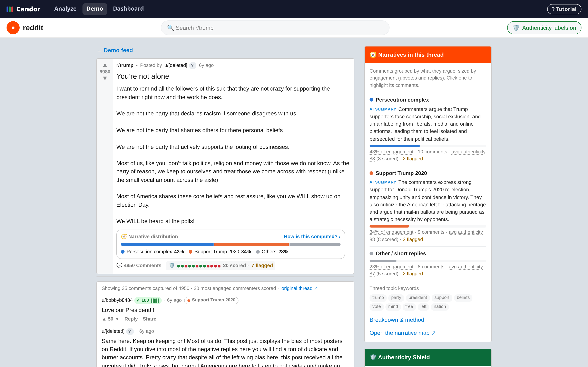</p>

- **Analyze** (`web/index.html`): paste any public Reddit link and the full pipeline runs live on it. Your past analyses are listed below the form (remembered with a cookie).
- **Demo** (`web/demo.html`): a feed of real threads analysed in advance by the live pipeline, each opening in the same result view as a live analysis (`view.html?id=ex-<id>`). Bundled with `python -m candor.examples <analysis_id> ...` into `web/examples/`.
- **Dashboard** (`web/dashboard.html`): the narrative map of 4,453 posts and comments from four subreddits.
- **Video Demo** (`web/video.html`): a narrated walkthrough of the site (under 2 minutes) with chapters, a transcript and a download button. The MP4 is committed in `web/video/`.

1. **What are people arguing?** Comments are grouped into narratives, and each narrative is weighted by its engagement (upvotes and replies).
2. **Who is pushing each narrative?** The most engaged commenters are scored for authenticity against signs of Coordinated Inauthentic Behaviour (CIB), such as bots, purchased accounts and coordinated campaigns.

Upvotes and top comments shape how we judge a post before we've read it. Candor doesn't ban or flag anyone. Instead, it shows the makeup of the accounts behind each narrative, using transparent, weighted criteria, so readers can judge for themselves.

Built at Junction 2026.

## Features

- **Live analysis:** paste a Reddit link and get results in about a minute.
- **Account authenticity scores:** each account is scored 0–100 on five criteria (profile, originality, coordination, engagement legitimacy and behavioural history), and you can see the breakdown behind every score.
- **Narrative detection:** comments are clustered by meaning, labelled and summarised by an LLM, and ranked by engagement.
- **Narrative composition:** for each narrative, see which kinds of accounts push it (likely authentic, uncertain or suspicious).
- **Narrative map:** an interactive map of every comment, with dots sized by upvotes and faded by author authenticity.
- **Cross-subreddit dashboard:** 4,453 posts and comments from four subreddits, grouped into 75 topics and 107 narratives, with a timeline, a ranking of narratives that lean on inauthentic accounts, and a "narrative weather" time-lapse.
- **Approachable:** tooltips on every number, a guided tutorial on each page, and a mobile-friendly layout.

## Tech stack

| Layer | Tools |
|---|---|
| Data collection | [context.dev](https://context.dev) (real-time Reddit posts, comments and profiles) |
| Embeddings | Google Gemini text embeddings |
| Clustering | UMAP + HDBSCAN (narratives), agglomerative clustering (topics) |
| Labels and summaries | NVIDIA Nemotron |
| Backend | Python, FastAPI, SQLite |
| Hosting | Hostinger VPS, nginx, systemd |

## Quick start

```bash
python -m venv .venv && .venv/bin/pip install -r requirements.txt
echo "CONTEXT_DEV_API_KEY=..." > .env
cp narrative-buckets/.env.example narrative-buckets/.env   # add GEMINI_API_KEY (NVIDIA_API_KEY optional)
.venv/bin/uvicorn candor.api:app --reload --port 8000     # → http://localhost:8000/
```

Locally, FastAPI also serves `web/`, so you don't need nginx. The live pipeline loads both `.env` files itself.

- Run the pipeline without the web app: `python -m candor.live <reddit_url>` (prints the `view.html?id=` to open).
- Dashboard map with author scores: `python -m candor.dashboard all` (scrapes and scores all 3,514 authors, ~1 credit each, then builds `data/dashboard/narrative-map.html`, which `GET /api/dashboard/map` serves ahead of the committed `web/dashboard/narrative-map.html`). `summarize` writes AI summaries; `build` refreshes the committed fallback. Inputs live in `data/dashboard/` (not in git).
- **Narrative weather** (Dashboard → time-lapse, `GET /api/dashboard/timelapse`): an animated replay of the narrative map, built by `candor.dashboard build`/`build-data` from the same data. All of it lives in `narrative-buckets/candor/timelapse.py`; to remove it, delete that module, its two calls in `candor/dashboard.py`, the endpoint and the view switch in `web/dashboard.html`.
- **Video Demo** (`web/video/candor-demo.mp4`, `poster.jpg`, `transcript.json`): rebuilt by `tools/demo_video/build.py`, which records the site with Playwright, narrates it with Piper (local TTS) and encodes it with ffmpeg. Dev-only deps: `python -m venv .venv-demo && .venv-demo/bin/pip install -r requirements-demo.txt` (plus ffmpeg and Chromium). The storyboard (narration + clicks) is the `SCENES` list in that file. Rebuild after UI changes so the video stays accurate; see the script's docstring for recording an unreleased checkout locally.
- Rebuild stored narrative maps after changing the map: `python -m candor.rebuild --all` (or `<id> ...`). Runs from before `embeddings.npy` was stored are re-embedded once with Gemini; no context.dev credits.
- Tests: `python -m pytest` (app, offline) and `cd narrative-buckets && python -m pytest` (Stage 2 engine).

---

## How it works

As you scroll the Internet, your feed fills with content, each piece pushing a narrative. Paste any public Reddit link into Candor, or browse threads we have already analysed.

<table>
<tr>
<td width="50%">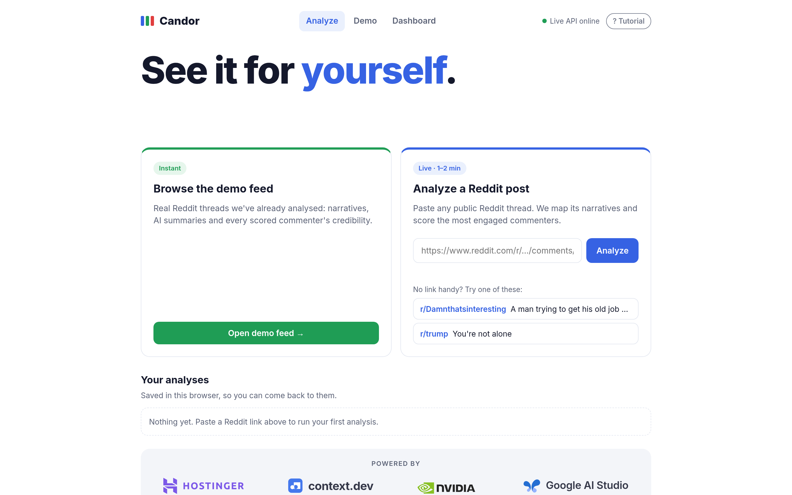</td>
<td width="50%">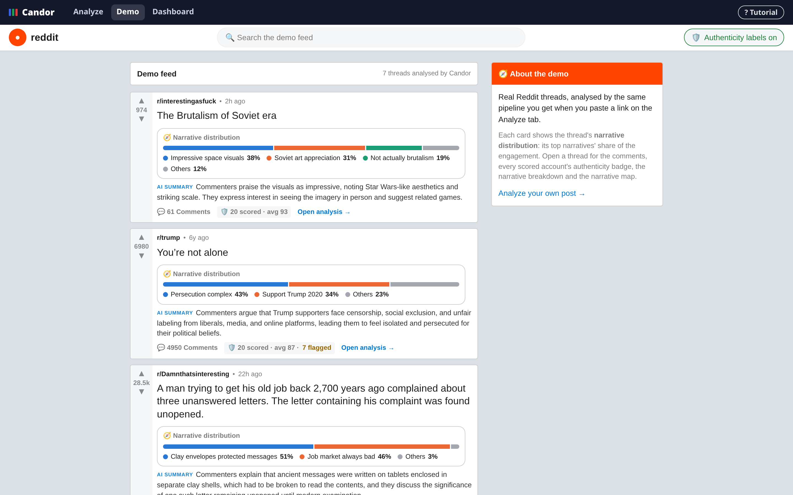</td>
</tr>
<tr>
<td align="center"><sub>Paste any public Reddit thread: results in about a minute</sub></td>
<td align="center"><sub>Or browse the demo feed of threads analysed by the live pipeline</sub></td>
</tr>
</table>

### Stage 1 · Who is talking?

[context.dev](https://context.dev) lets us query structured data from posts and comments in real time, as news and trends develop.

An algorithm then characterises the accounts commenting under the post. We check them against behavioural patterns that match **Coordinated Inauthentic Behaviour (CIB)**, the kind shown by bots and purchased accounts. Every account is scored 0–100 on five weighted, transparent criteria:

| | Criterion | The question it asks |
|---|---|---|
| C1 | Profile | Is this an established, real person? |
| C2 | Originality | Did this person write it? |
| C3 | Coordination | Is it acting in concert with others? |
| C4 | Engagement legitimacy | Did it earn its upvotes organically? |
| C5 | Behavioural history | Does the account do this elsewhere? |

<table>
<tr>
<td width="50%">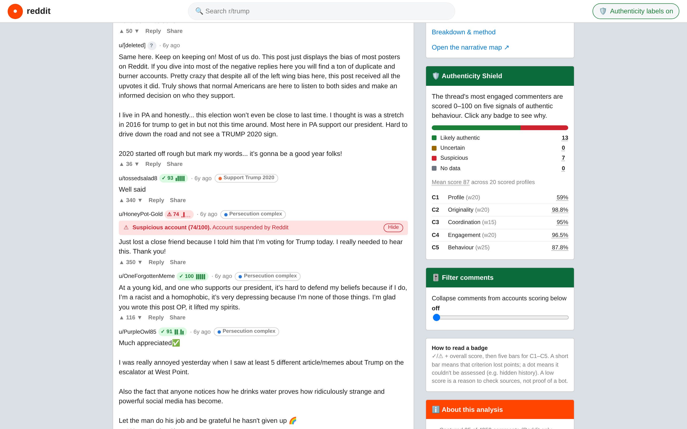</td>
<td width="50%">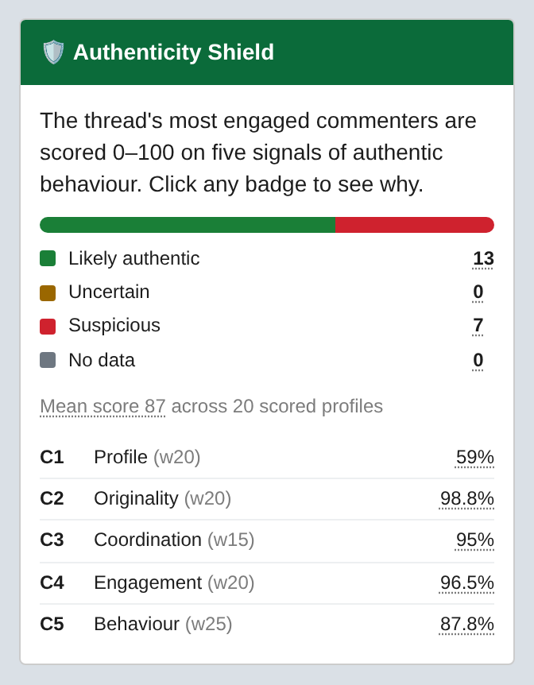</td>
</tr>
<tr>
<td align="center"><sub>Click any badge to see why an account scored the way it did</sub></td>
<td align="center"><sub>The Authenticity Shield sums up who is in the thread</sub></td>
</tr>
</table>

### Stage 2 · What are they saying?

Using **Gemini's text embedding model**, each comment is turned into a vector, so text can be compared mathematically. **HDBSCAN** then finds dense clusters of comments that mean the same thing. **NVIDIA Nemotron** groups similar clusters into broader topics with agglomerative clustering, and explains what each group means: **the narrative**.

<table>
<tr>
<td width="50%">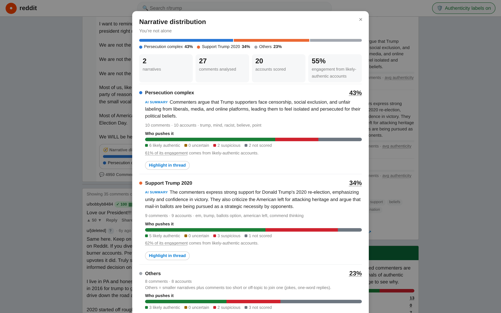</td>
<td width="50%">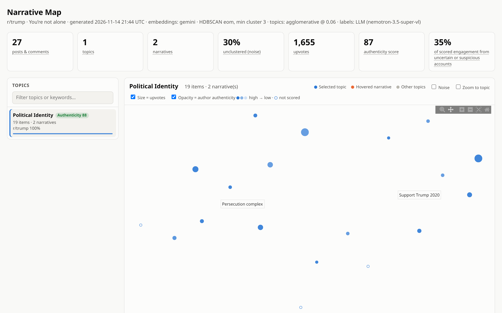</td>
</tr>
<tr>
<td align="center"><sub>Each narrative's share of the conversation, and which kinds of accounts push it</sub></td>
<td align="center"><sub>The narrative map: dots sized by upvotes, faded by author authenticity</sub></td>
</tr>
</table>

These narratives are then clustered across the Internet, building up the most relevant topics online.

<p align="center">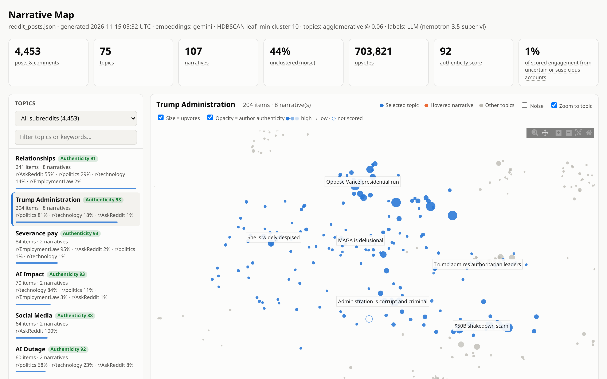</p>
<p align="center"><sub>The Dashboard: 4,453 posts and comments from four subreddits, grouped into 75 topics and 107 narratives</sub></p>

### Stage 3 · Showing you

The last stage is communicating what we've learned to **you**.

What we show you is **not a verdict on any person or any narrative**. It is the composition of the kinds of accounts supporting a narrative: through time, in every post, and across a channel, based on weighted, transparent criteria.

<table>
<tr>
<td width="50%">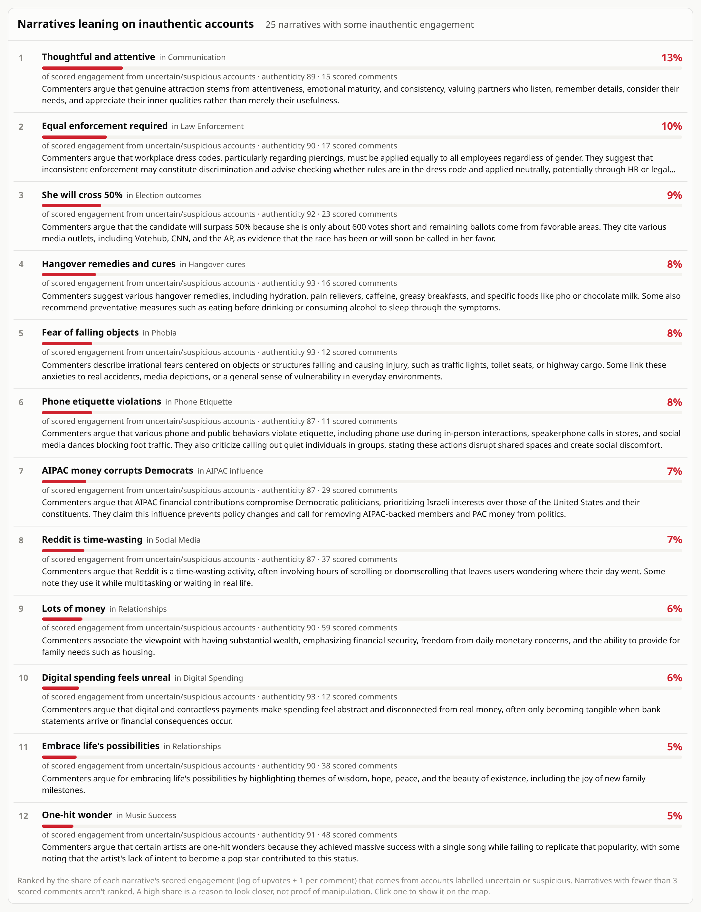</td>
<td width="50%">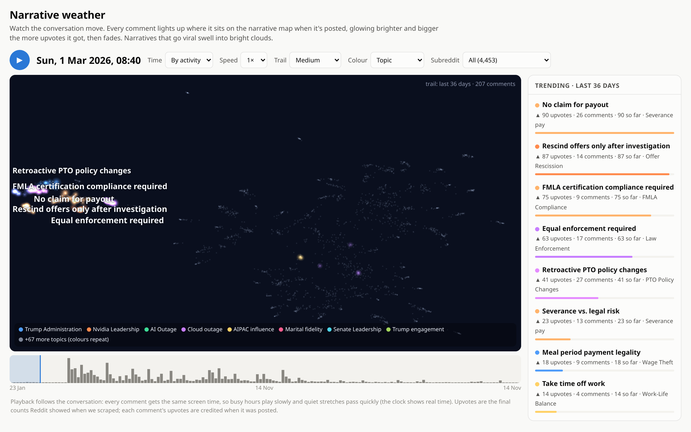</td>
</tr>
<tr>
<td align="center"><sub>Which narratives lean on inauthentic accounts</sub></td>
<td align="center"><sub>Narrative weather: watch narratives form and swell over time</sub></td>
</tr>
</table>

Every number explains itself on hover, a built-in tutorial walks first-time visitors through each page, and it all works on a phone.

<p align="center">
  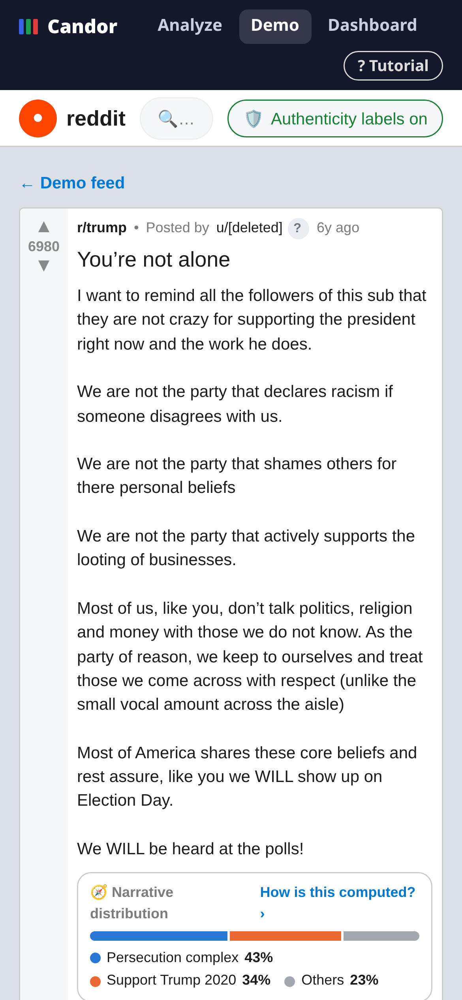
  &nbsp;
  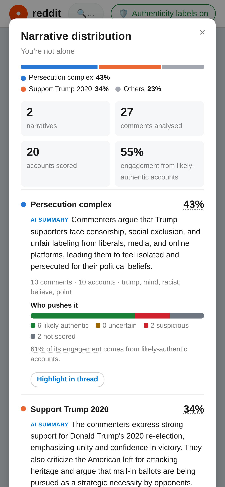
  &nbsp;
  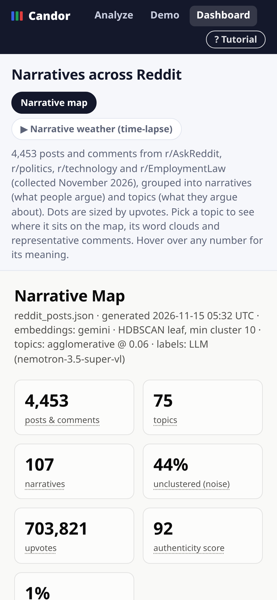
</p>

---

## Our mission

To give a bigger view of what goes on across the Internet, and to cut through the noise. We want you to see what real people, with their own real intentions, are saying. **Empowering you with accessible transparency.**

Not just for users: Candor also provides narrative-monitoring capability to experts in politics, disaster risk reduction, health, sovereignty and legislation.

## Roadmap

| | Value now | Value later |
|---|---|---|
| **Scope** | We assess the narratives formed in every post. | With fewer resource limits, we combine these insights across an entire channel, or the entire platform, in real time. |
| **Platforms** | We are targeting Reddit. | As other social media platforms adopt Candor, we gain transparency into which platforms reliably protect their users from targeted content. |
| **Governance** | Open to the public. | Supporting governing bodies such as the European Commission (DG CONNECT) and the European External Action Service (EEAS), which address political and foreign information manipulation and interference, as they develop legislation. |

---

## Closing

Social media was built as a space to connect. Now we scroll through noise, wondering who's real and who's paid.

| Path | What |
|---|---|
| [candor/api.py](candor/api.py) | FastAPI app (endpoints above); serves `web/` locally |
| [candor/live.py](candor/live.py) | Live pipeline `analyze(id, url, progress)` |
| [candor/scrape.py](candor/scrape.py) | Scrapes one Reddit thread with context.dev into the base post format |
| [candor/profiles.py](candor/profiles.py) | Picks the most engaged commenters and scrapes their profiles (cached) |
| [candor/scoring.py](candor/scoring.py) | Thread topic keywords + live account scoring |
| [candor/view.py](candor/view.py) | Builds the mockup data (threads, profiles, narratives) |
| [candor/store.py](candor/store.py) | SQLite index + per-analysis files |
| [candor/urls.py](candor/urls.py) | Reddit URL validation and normalisation |
| [candor/rebuild.py](candor/rebuild.py) | Rebuilds stored analyses' `map.html` |
| [candor/SCRAPING.md](candor/SCRAPING.md) | Design doc for the live scraping stage, including the planned profile scraping and scoring |
| [candor/\_\_init\_\_.py](candor/__init__.py) | Adds `narrative-buckets/candor` to the `candor` package's import path, so both codebases import as `candor.*` |
| [web/index.html](web/index.html) | Analyze tab: paste a link, your past analyses |
| [web/view.html](web/view.html) | A live analysis in the Reddit mockup (`?id=`); the template without data |
| [web/demo.html](web/demo.html) | Simulated Reddit feed (template + dataset-2 data) |
| [web/dashboard.html](web/dashboard.html) | Dashboard tab; embeds `web/dashboard/narrative-map.html` |
| [web/video.html](web/video.html) | Video Demo tab: player, download, chapters and transcript for `web/video/` |
| [tools/demo_video/build.py](tools/demo_video/build.py) | Builds the narrated demo video (`requirements-demo.txt`) |
| [web/analyze.html](web/analyze.html) | Redirects old links to the Analyze tab |
| [web/tour.js](web/tour.js) | Guided tutorial shared by all pages |
| `web/example/` | The tutorial's example result (`view.json` + `map.html` of one r/politics analysis) |
| [mockup/template.html](mockup/template.html) | The Reddit mockup used by demo.html and view.html. `mockup/build_mockup.py` regenerates both (demo from `data/dataset2`; note this changes the demo, whose committed data predates the current `profile_scores.json`). |
| `web/logos/` | Partner logos (context.dev, Hostinger, NVIDIA) |
| [deploy/](deploy/) | `deploy.sh`, `setup_vps.sh`, `candor.service`, `nginx-candor.conf` (see above) |
| [requirements.txt](requirements.txt) | Server dependencies (FastAPI, context.dev, UMAP, HDBSCAN, Gemini/NVIDIA clients). The local MiniLM/torch model is deliberately left out. |
| [tests/](tests/) | Offline tests: API/storage, URL handling, live scoring |

### Narrative buckets (Stage 2)

| Path | What |
|---|---|
| [narrative-buckets/](narrative-buckets/) | Narrative clustering engine. See its [README](narrative-buckets/README.md) and `AGENT.md`. |
| `narrative-buckets/candor/spatial_engine.py` | Embed → UMAP → HDBSCAN narratives → topic grouping → labels |
| `narrative-buckets/candor/ingest.py` | Flattens nested Reddit posts into comment records |
| `narrative-buckets/candor/embedders.py`, `labeling.py`, `representation.py` | Gemini or local embeddings, LLM or keyword labels, c-TF-IDF |
| `narrative-buckets/candor/visualize.py` | Writes the interactive narrative-map HTML |
| `narrative-buckets/candor/pipeline.py` | Batch command-line tool (not used by the live API); produced the Dashboard map |
| `narrative-buckets/tests/` | Offline tests |
| `narrative-buckets/out/` | Batch outputs (reports, embedding caches) |

### Account credibility scoring (Stage 3)

| Path | What |
|---|---|
| [profile_authenticity_scorer.py](profile_authenticity_scorer.py) | Scores Reddit accounts 0–100 on C1 profile (20), C2 originality (20), C3 coordination (15), C4 engagement legitimacy (20), C5 behavioural history (25). 100 = looks authentic. Offline (dataset 2) and live (`score_live`) modes. |
| [reference/cohort_dataset2.json](reference/cohort_dataset2.json) | Frozen comparison cohort for live scoring |
| [score_overview.py](score_overview.py) | Summary of the profile scores |
| [scorer.py](scorer.py), [evaluate.py](evaluate.py), [generate_test_data.py](generate_test_data.py) | Earlier comment-level scorer (Facebook format), its evaluation and synthetic test data |
We can't fix the crowd. But we can show you who's in it.

<p align="center"><b>See it for yourself. See it with Candor.</b><br><a href="https://candor-junction-2026.tech">candor-junction-2026.tech</a></p>

---

<p align="center"><sub>Built at Junction 2026 with <a href="https://context.dev">context.dev</a>, Google AI Studio (Gemini), NVIDIA (Nemotron) and Hostinger.<br>How it's built, hosted and run: <a href="TECHNICAL.md">TECHNICAL.md</a> · Every feature screenshotted: <a href="docs/screenshots/">docs/screenshots</a></sub></p>
